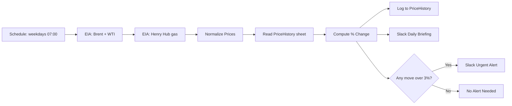

# Daily Oil & Gas Price Briefing (n8n)

An [n8n](https://n8n.io) workflow that checks the price of **Brent crude, WTI crude and Henry Hub natural gas** every weekday morning, compares it with the last saved price, and sends a short summary to **Slack**. If any price moves by **more than 3%**, it also sends an urgent alert.

No coding needed to run it. Import the file, connect three accounts, and switch it on.

<!-- Add a screenshot of your workflow here: -->
<!--  -->

---

## What it does

1. **Wakes up** every weekday at 07:00.
2. **Gets prices** from the free [EIA API](https://www.eia.gov/opendata/) (US Energy Information Administration): Brent, WTI and Henry Hub gas.
3. **Reads your Google Sheet** to find the last saved prices.
4. **Works out the % change** for each price.
5. **Saves today's prices** to the same sheet, so you build a price history over time.
6. **Sends a Slack briefing** every day.
7. **Sends an urgent Slack alert** if any price moved more than 3%.

### Example Slack briefing

```
🛢 Daily oil and gas price briefing - 2026-10-12
- Brent: $00.00 (+0.00% vs 2026-10-09)
- WTI: $00.00 (+0.00% vs 2026-10-09)
- Henry Hub gas: $0.00 (+0.00% vs 2026-10-09)
```
*(Numbers above are placeholders, not real prices.)*

---

## How it works



| Step | Node | What it does |
|---|---|---|
| 1 | Weekdays at 07:00 | Starts the workflow (Mon-Fri) |
| 2 | EIA Crude Oil (Brent + WTI) | Gets the latest crude prices |
| 3 | EIA Natural Gas (Henry Hub) | Gets the latest gas price |
| 4 | Normalize Prices | Cleans the data into one simple record |
| 5 | Read PriceHistory | Reads previous prices from Google Sheets |
| 6 | Compute % Change | Calculates the change and writes the messages |
| 7 | Log to PriceHistory | Adds today's row to the sheet |
| 8 | Slack Daily Briefing | Posts the daily summary |
| 9 | Any Move Over 3% | Checks if an alert is needed |
| 10 | Slack Urgent Alert | Posts the alert (only if needed) |

---

## What you need

- **n8n** (cloud or self-hosted). Tested on a self-hosted Docker setup.
- A free **EIA API key**: https://www.eia.gov/opendata/register.php
- A **Google account** (for Google Sheets)
- A **Slack workspace** where you can add an app

---

## Quick setup

Full step-by-step guide: [docs/setup-guide.md](docs/setup-guide.md)

1. **Import** `workflow/01-daily-oil-price-briefing.json` into n8n (Workflows → Import from File).
2. **Create a Google Sheet** with a tab called `PriceHistory` and this header row:

   ```
   date | brent_usd | wti_usd | natgas_usd | brent_change_pct | wti_change_pct | natgas_change_pct
   ```
   You can copy the sample in [`sample-data/PriceHistory-sample.csv`](sample-data/PriceHistory-sample.csv).
3. **Create three credentials** in n8n:

   | Name | Type | Notes |
   |---|---|---|
   | `EIA API Key` | Query Auth | Name = `api_key`, Value = your EIA key |
   | `Google Sheets account` | Google Sheets OAuth2 | Sign in with Google |
   | `Slack account` | Slack API | Needs the `chat:write` permission |
4. **Edit the nodes:**
   - Put your Google Sheet link in **Read PriceHistory** and **Log to PriceHistory** (replace `REPLACE_WITH_GOOGLE_SHEET_ID`).
   - Pick your Slack channel in **Slack Daily Briefing** and **Slack Urgent Alert**.
5. **Test it:** click **Execute Workflow** and check Slack and your sheet.
6. **Switch it on:** turn the **Active** toggle on.

---

## Settings you can change

| What | Where | Default |
|---|---|---|
| Alert level | `THRESHOLD_PCT` in the **Compute % Change** node | `3` (%) |
| Run time | **Weekdays at 07:00** node (cron `0 7 * * 1-5`) | 07:00 Mon-Fri |
| Time zone | n8n Settings, or `GENERIC_TIMEZONE` for Docker | Server time zone |
| Slack channels | Both Slack nodes | Your choice |

---

## Good to know

- **EIA data can be a day or more old.** EIA does not always publish the newest day right away, so the price you get may not be today's. Check the [EIA release schedule](https://www.eia.gov/opendata/).
- **The `date` column is the day the workflow ran**, not the date of the price.
- **It compares with the last row in your sheet**, which may not be the previous trading day (for example after a weekend or holiday).
- **The first run shows "n/a" for changes**, because there is no earlier row yet. Add one sample row (or run it twice on different days) to test the % change.
- **Add your Slack app to the channel** you choose, or the message may fail.
- **For information only.** This is not trading or financial advice.

---

## Security

- This repo contains **no passwords, API keys or private IDs**. The workflow file only has placeholders.
- Keep your keys inside **n8n credentials**. Never paste them into a node.
- Before sharing your own exported workflow, check it for real sheet links and credential IDs. See [SECURITY.md](SECURITY.md).

---

## Ideas for next steps

- Add more commodities (for example, other EIA series)
- Send the briefing by email or Telegram too
- Add a chart of the price history
- Add an AI step to write a one-line market summary
- Connect an error workflow so you hear about failures

---

## Contributing

Ideas and fixes are welcome. See [CONTRIBUTING.md](CONTRIBUTING.md).

## License

[MIT](LICENSE)

## Author

Built by **Joe Akpan**. Connect with me on [X](https://x.com/JoeAkpan28)).

*Built with n8n. Documentation of the workflow was created with help from an AI coding assistant and then reviewed by me.*
